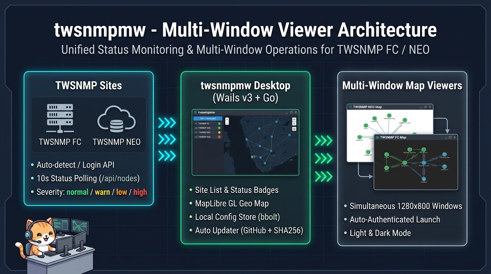
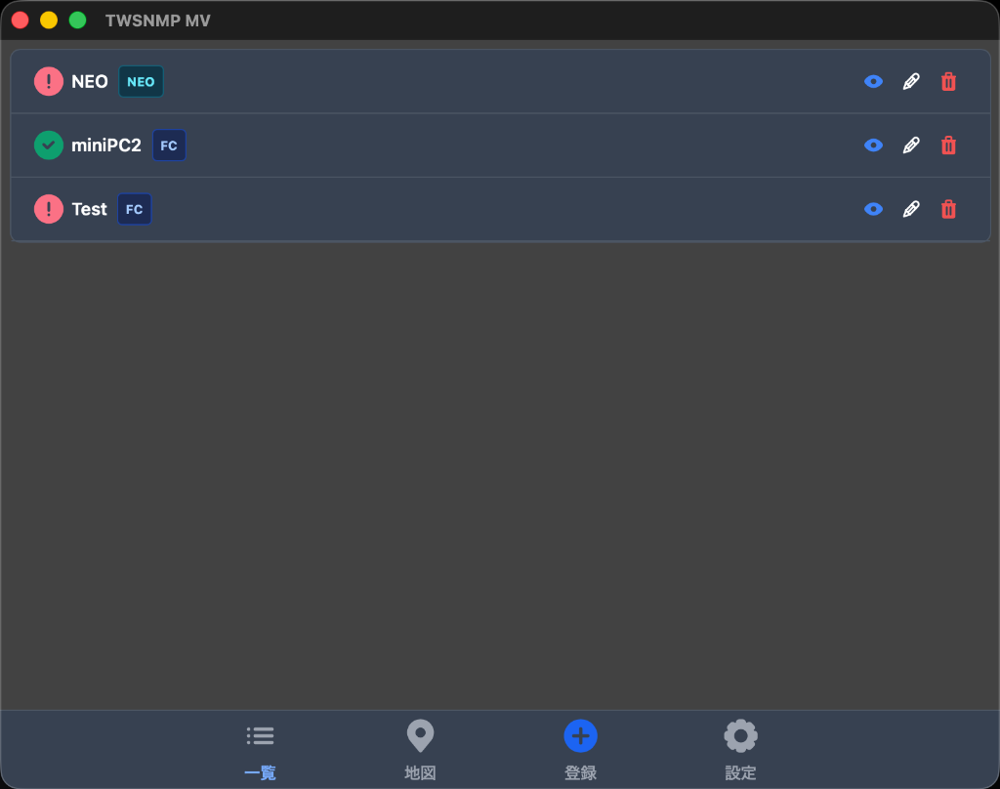
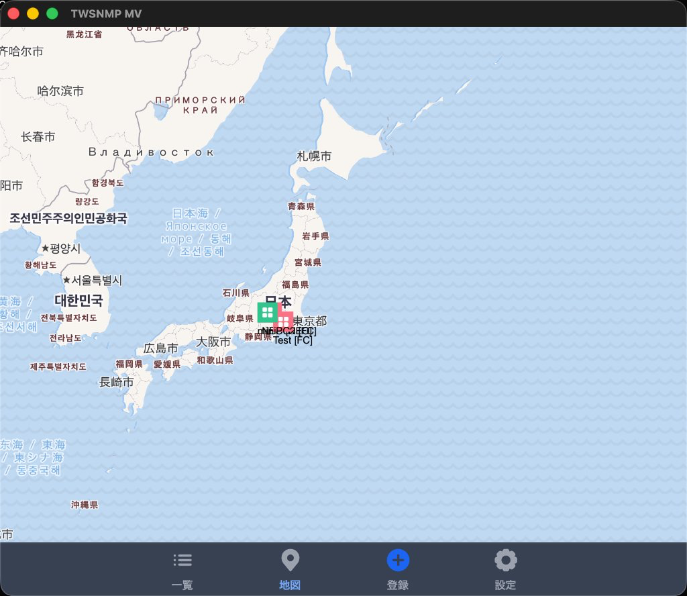
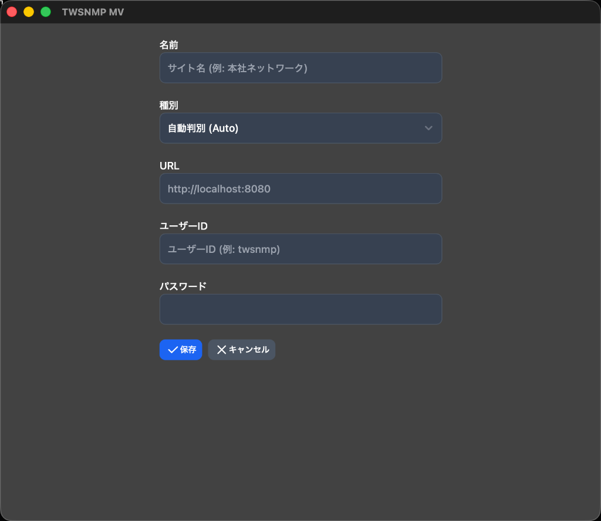
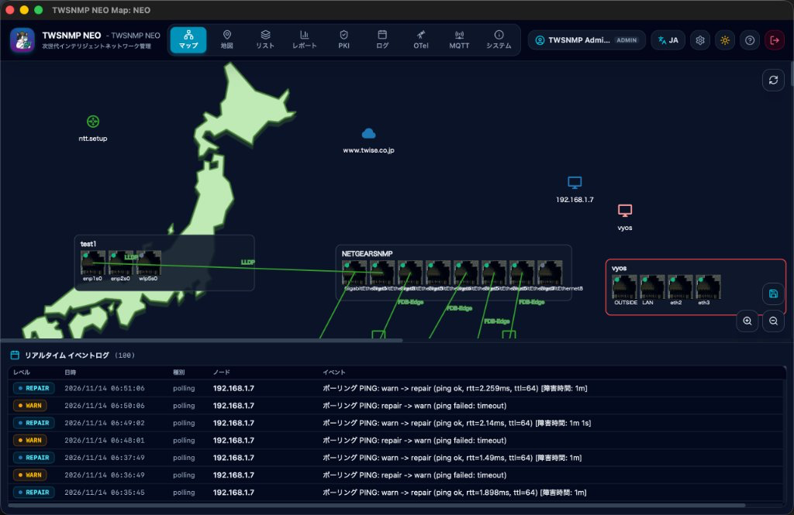
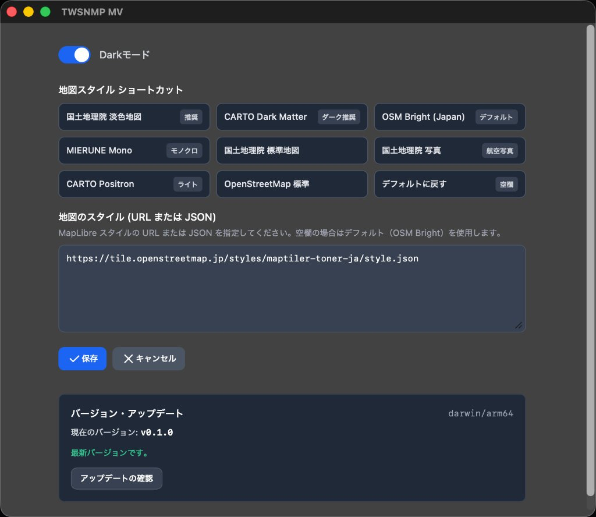

# twsnmpmw 🖥️🗺️

**twsnmpmw（TWSNMP Multi Window）** は、複数の **TWSNMP FC** および **TWSNMP NEO** サーバーを一元管理し、ノード状態のリアルタイム監視、地理マップ上での拠点配置、および各サイトの専用マップを複数ウィンドウで同時に開いて監視できるデスクトップアプリケーションです。[Wails v3](https://wails.io/) と [SolidJS](https://www.solidjs.com/)、Go で構築されており、TWSNMP シリーズプロジェクトの一つです。

---

## 🗺️ システム構成・ワークフロー



*twsnmpmw は、複数拠点の TWSNMP FC / TWSNMP NEO に対するバックグラウンド自動ログイン・状態監視（10秒間隔）から、一覧・地図上でのステータス集約表示、各サイト専用のマルチウィンドウ（1280×800）起動、GitHub Releases 連携の自己アップデートまでを統合したデスクトップアプリケーションです。*

---

## ✨ 主な特徴

- 🌐 **TWSNMP FC / TWSNMP NEO 両対応（自動判別）** — 接続先の種別を自動判別（`自動判別 (Auto)`: NEO を試行後に FC を試行）または明示指定（`TWSNMP NEO` / `TWSNMP FC`）でき、一覧および地図上に種別バッジを表示
- 🔄 **10秒間隔のバックグラウンド状態監視** — 登録された全サイトの `/api/nodes` を 10 秒ごとに自動ポーリングし、全ノードの中で最も深刻な状態をサイトステータス（`high` / `low` / `warn` / `normal` / `unknown`）として集約表示（自己署名 HTTPS 証明書にも対応、トークン失効時は自動で再ログイン）
- 🪟 **マルチウィンドウでのマップ同時表示** — 一覧または地図からサイトを選択すると、`1280×800` の独立したネイティブウィンドウ（`TWSNMP NEO Map: <サイト名>` / `TWSNMP FC Map: <サイト名>`）を開き、複数の拠点や顧客環境を並べて同時監視可能（認証パラメータやトークンも自動引き継ぎ）
- 🗺️ **MapLibre GL による地理マップ表示** — 世界・日本地図上に各サイトを状態別のカラーマーカーで配置。マーカーのドラッグ＆ドロップで位置（緯度・経度）を保存でき、表示中のズーム率・中心座標（Viewport）も自動記憶
- 🌙 **ダークモード & 豊富な地図スタイル設定** — 設定画面からライト／ダークモードを切り替えられるほか、9種類の地図スタイルショートカット（国土地理院・CARTO・MIERUNE・OpenStreetMap 等）や任意の MapLibre スタイル URL／JSON の直接指定に対応
- 💾 **完全ローカル永続化** — 組み込み Key-Value ストア（[bbolt](https://github.com/etcd-io/bbolt)）により、サイト設定・座標・表示設定をローカルデータベース（`twsnmpmw.db`）に安全に保存
- ⬆️ **GitHub Releases 連携の自己アップデート** — 起動時のバックグラウンド更新チェックと手動チェックに対応。更新検出時は設定タブに通知バッジを表示し、`SHA256SUMS` によるチェックサム検証付きのダウンロード・適用・再起動をワンクリックで実行
- 💻 **マルチプラットフォーム対応** — macOS（Apple Silicon）、Windows（x64）、Linux（x64）向けのネイティブデスクトップアプリとして動作

---

## 🖥️ 画面と操作方法

twsnmpmw は、画面下部のナビゲーションバー（`一覧` / `地図` / `登録` / `設定`）から直感的に各機能を切り替えられます。

### 1. サイト一覧画面（一覧タブ）


- **登録サイトの状態一覧**:
  - 登録されているすべての TWSNMP FC / TWSNMP NEO サイトについて、状態アイコン・サイト名・種別バッジ（シアン色の `NEO` または青色の `FC`）を一覧表示します。
  - 10 秒ごとのバックグラウンド監視結果がリアルタイムに反映されます。
- **サイト操作ボタン（各行右側）**:
  - **マップを開く（目のアイコン）**: そのサイト専用のマップウィンドウ（`1280×800`）を新しいウィンドウで開きます。
  - **編集（鉛筆アイコン）**: サイトの名前・種別・URL・認証情報を編集します。
  - **削除（ゴミ箱アイコン）**: サイトを登録一覧から削除します。

| 状態アイコン色 | 内部ステータス | 意味（ノード状態からの集約結果） |
|---|---|---|
| 🟢 緑 | `normal` | すべての監視ノードが正常（`normal` / `repair`） |
| 🟡 黄 | `warn` | 警告（`warn`）状態のノードが存在 |
| 🩷 ローズ | `low` | 軽度障害（`low`）状態のノードが存在 |
| 🔴 赤 | `high` | 重度障害（`high`）状態のノードが存在 |
| ⚪ グレー | `unknown` | 未確認、接続不可、または認証失敗 |

### 2. 地図表示画面（地図タブ）


- **地理マップ上のステータス可視化**:
  - [MapLibre GL](https://maplibre.org/) を用いて、各サイトをステータスに応じた色付きアイコン（`high`: 赤、`low`: ローズ、`warn`: 黄、`normal`: 緑、`unknown`: グレー）と `<サイト名> [NEO]` / `[FC]` ラベルで地図上に表示します。
  - デフォルトでは OpenStreetMap Japan スタイル（`https://tile.openstreetmap.jp/styles/osm-bright-ja/style.json`）を使用し、初期中心は東京付近（`139.75, 35.68`）に設定されています。
- **ドラッグ＆ドロップによる位置設定**:
  - 新規登録したサイトのマーカーは、地図上でドラッグ＆ドロップするだけで任意の拠点位置（経度・緯度）へ移動でき、変更は即座に `twsnmpmw.db` に保存されます。
- **ワンクリックでマップウィンドウ起動**:
  - 地図上のマーカーをクリックするとサイト URL のポップアップボタンが表示され、クリックすることで専用マップウィンドウが開きます。
- **表示位置の自動記憶**:
  - 他の画面へ切り替える際、現在のズームレベルと中心座標を自動保存し、次回「地図」タブを開いたときに復元します。

### 3. サイト登録・編集画面（登録タブ / 編集ボタン）


- **入力項目**:
  - **名前**: 一覧や地図、マップウィンドウのタイトルに表示される識別名（例: `本社ネットワーク`）
  - **種別**: `自動判別 (Auto)` / `TWSNMP NEO` / `TWSNMP FC` から選択
  - **URL**: TWSNMP サーバーの接続先 URL（例: `http://localhost:8080` や `https://192.168.1.10:8080`）。自己署名証明書を用いた HTTPS 接続にも対応しています。
  - **ユーザーID / パスワード**: TWSNMP へのログインおよび状態監視 API 認証に使用する資格情報
- 下部の「保存」ボタンで登録・更新し、「キャンセル」で元の画面に戻ります。

### 4. サイト別マップウィンドウ表示（マルチウィンドウ対応）


*例: メイン画面から TWSNMP NEO サイトを開いた専用マップウィンドウ（`TWSNMP NEO Map: NEO`）*

- **複数サイトの同時表示**:
  - 一覧や地図から各サイトを開くことで、それぞれ独立した `1280×800` の専用ウィンドウが立ち上がり、複数の拠点やサーバーのマップを画面上に並べて同時に監視できます。
  - ウィンドウタイトルには接続先種別に応じて `TWSNMP NEO Map: <サイト名>` または `TWSNMP FC Map: <サイト名>`（未判別時は `TWSNMP Map: <サイト名>`）が表示されます。
- **自動ログイン連携**:
  - ウィンドウを開く際、TWSNMP FC 用パラメータ（`UserID` / `Password`）および TWSNMP NEO 用パラメータ（`user` / `password` / `token`）をクエリパラメータとして自動で付与します。

> [!NOTE]
> macOS 版では最後のウィンドウを閉じるとアプリケーションが終了する設定になっています。メインウィンドウを開いたままにしておくと、複数のサイトマップウィンドウを自由に開閉しながら運用できます。

### 5. 設定・アップデート画面（設定タブ）


- **表示設定**:
  - **Darkモード**: スイッチの ON / OFF で画面全体のライトテーマ・ダークテーマを切り替えます。
  - **地図スタイル ショートカット**: ワンクリックで地図タイルを切り替えられる 9 種類のプリセットを用意しています。
    - `国土地理院 淡色地図`（推奨） / `CARTO Dark Matter`（ダーク推奨） / `OSM Bright (Japan)`（デフォルト） / `MIERUNE Mono`（モノクロ） / `国土地理院 標準地図` / `国土地理院 写真`（航空写真） / `CARTO Positron`（ライト） / `OpenStreetMap 標準` / `デフォルトに戻す`（空欄）
  - **地図のスタイル (URL または JSON)**: MapLibre スタイルの URL（`http://`・`https://`・相対パス）または JSON オブジェクト（`{ ... }`）を直接編集できます（入力時に形式を検証し、空欄の場合はデフォルトの OSM Bright を使用します）。
  - 「保存」ボタンで設定をデータベースに保存し即座に反映します。
- **バージョン・アップデート**:
  - 実行プラットフォーム／アーキテクチャ（例: `darwin/arm64`, `windows/amd64`, `linux/amd64`）および現在のバージョン（例: `v0.1.0 (<commit>)`）を表示します。
  - アプリ起動から約 1.5 秒後に GitHub Releases（`twsnmp/twsnmpmw`）へのバックグラウンド更新確認を自動実行し、新しいバージョンが検出された場合は下部ナビゲーションの「設定」アイコン右上に赤い通知バッジが表示されます。
  - **アップデートの確認**: 手動で最新リリースの有無を確認します。
  - **アップデートを実施**: 新バージョンがある場合、リリースノートを確認したうえでダウンロード（進捗バー・容量表示つき）→ `SHA256SUMS` チェックサム検証 → インストール → アプリ再起動までを自動で実行します。

---

## 🔍 対応する TWSNMP と監視・認証仕様

### 接続方式・API 仕様

| サイト種別 | ログイン API | マップ起動時パラメータ | ノード状態監視 API |
|---|---|---|---|
| **TWSNMP NEO** (`neo`) | `POST <URL>/api/login`<br>(`user`, `password`) | `user`, `password`, `token` | `GET <URL>/api/nodes`<br>(`Authorization: Bearer <token>`) |
| **TWSNMP FC** (`fc`) | `POST <URL>/login`<br>(`UserID`, `Password`) | `UserID`, `Password`（取得時は `token` も付与） | `GET <URL>/api/nodes`<br>(`Authorization: Bearer <token>`) |
| **自動判別** (`auto`) | NEO（`/api/login`）を試行し、失敗時に FC（`/login`）を試行 | 判別された種別に応じて付与 | 同上（`401` 応答時はトークンをリセットして次回再ログイン） |

- ポーリング間隔: **10 秒**（HTTP タイムアウト: **3 秒**）
- ステータス優先順位（1 サイト内の全ノードから最も深刻な状態を採用）:
  `high` ＞ `low` ＞ `warn` ＞ `normal`（`repair` 含む） ＞ `unknown`

---

## 🛠️ 技術スタック

| コンポーネント | 採用技術 |
|---|---|
| **デスクトップ基盤** | [Wails v3](https://wails.io/) (`v3.0.0`) |
| **バックエンド** | Go 1.27 (`go 1.27.2`) |
| **フロントエンド** | [SolidJS](https://www.solidjs.com/) + TypeScript + [Tailwind CSS](https://tailwindcss.com/) + [Flowbite](https://flowbite.com/) |
| **地図エンジン** | [MapLibre GL](https://maplibre.org/) (`maplibre-gl`) + `solid-map-gl` |
| **データベース** | [bbolt](https://github.com/etcd-io/bbolt)（組み込み Key-Value ストア） |
| **自動アップデート** | Wails v3 Updater（GitHub Releases + `SHA256SUMS` 検証） |
| **E2E テスト** | Wails v3 MCP Server (`-tags mcp`) + Go E2E テスト (`./e2e`) |
| **パッケージング / CI** | GitHub Actions（Windows / Linux）、macOS 署名・公証スクリプト（`scripts/release-mac.sh`） |

---

## 🚀 インストールと起動

### 配布パッケージの利用

[Releases](https://github.com/twsnmp/twsnmpmw/releases) より、お使いの OS に合ったアーカイブをダウンロードしてください。

- **macOS (Apple Silicon)**: `twsnmpmw-darwin-arm64.zip` をダウンロード・展開し、`twsnmpmw.app` を「アプリケーション」フォルダへコピーして起動してください（Developer ID 署名・Apple 公証対応）。
- **Windows (x64)**: `twsnmpmw-windows-amd64.zip` をダウンロードして任意のフォルダに展開し、`twsnmpmw.exe` を実行してください（Microsoft Edge WebView2 ランタイムを使用します）。
- **Linux (x64)**: `twsnmpmw-linux-amd64.tar.gz` を展開して `./twsnmpmw` を実行してください（Ubuntu 24.04+ / Debian 系では `libgtk-4-1` や `libwebkitgtk-6.0-4` などのランタイムが必要です）。

### 環境変数による動作カスタマイズ（オプション）

| 環境変数 | 説明 |
|---|---|
| `TWSNMPMW_CONFIG_DIR` | 設定データベース（`twsnmpmw/twsnmpmw.db`）の保存ベースディレクトリを指定します。 |
| `TWSNMPMW_DISABLE_AUTO_UPDATE=1` | 起動時のバックグラウンドアップデート確認を無効化します（インターネット接続のない閉域網環境など）。 |

---

## 💻 開発環境のセットアップ

### 前提条件

- [Go](https://go.dev/) 1.27 以上
- [Node.js](https://nodejs.org/) 22 以上
- [Wails CLI v3](https://wails.io/) (`go install github.com/wailsapp/wails/v3/cmd/wails3@v3.0.0`)
- [Task](https://taskfile.dev/)（`Taskfile.yml` の実行に使用）
- Linux ビルド時の追加パッケージ（Ubuntu / Debian 例）:
  ```bash
  sudo apt-get update
  sudo apt-get install -y libgtk-4-dev libwebkitgtk-6.0-dev build-essential pkg-config
  ```

### 依存関係のセットアップ

```bash
# フロントエンドの依存関係インストール
cd frontend
npm install
cd ..
```

### 開発モード起動 (ホットリロード)

```bash
task dev
# または
wails3 dev -config ./build/config.yml -port 9245
```

### テスト・E2E テスト

```bash
# Go 単体テスト（アップデータ等のテスト）
go test -v ./...

# Wails v3 MCP サーバー有効ビルド & E2E テスト実行
task test:e2e
```

> [!TIP]
> `task run:mcp` を実行すると、Wails v3 MCP サーバーを有効にした状態でアプリを起動できます（エンドポイント: `http://127.0.0.1:9099/mcp`）。

### ビルド・パッケージング

```bash
# ローカル環境向けビルド
task build

# アプリバンドル / パッケージ作成
task package

# macOS 向け Developer ID 署名・Apple 公証済み配布 ZIP の作成
./scripts/release-mac.sh v0.2.0
```

---

## 🗄️ データ保存場所

登録されたサイト情報（接続先 URL・認証情報・地図座標）や表示設定（ダークモード・地図スタイル・Viewport）は、以下のパスの bbolt データベースファイルに保存されます（環境変数 `TWSNMPMW_CONFIG_DIR` を指定した場合は `$TWSNMPMW_CONFIG_DIR/twsnmpmw/twsnmpmw.db` が使用されます）。

| OS | デフォルトパス |
|---|---|
| **macOS** | `~/Library/Application Support/twsnmpmw/twsnmpmw.db` |
| **Windows** | `%APPDATA%\twsnmpmw\twsnmpmw.db` |
| **Linux** | `~/.config/twsnmpmw/twsnmpmw.db` |

---

## 📄 ライセンス

[Apache License 2.0](LICENSE)
